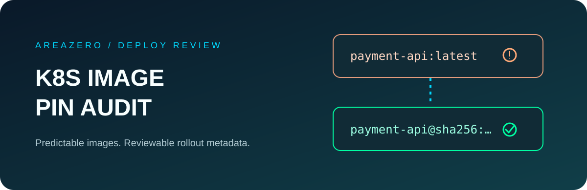

<p align="center"></p>
<p align="center"></p>

# Kubernetes Image Pin Audit

**Spot non-reproducible image references before they reach your cluster.** An offline, read-only Agent Skill for Claude Code and Codex that detects `:latest`, mutable image tags, malformed `sha256` digests, `Never` pull policies and risky `IfNotPresent`+tag combinations in rendered Kubernetes manifests.

[](https://github.com/Kanompung1988/k8s-image-pin-audit/actions/workflows/ci.yml) · [Agent Skills specification](https://agentskills.io/specification) · [Rules](references/RULES.md) · [MIT License](LICENSE)

## Why it exists

Kubernetes treats tags and digests differently. A tag can move, while a digest uniquely identifies content. An unpinned image may deploy different bytes across nodes or rollouts. The default `imagePullPolicy` is determined when the object is **first created**, and later changes to a tag do not necessarily update the policy. This review tool helps a coding agent identify fragile definitions *before* deployment, but cannot prove actual cluster behavior.

## Quickstart

```bash
git clone https://github.com/Kanompung1988/k8s-image-pin-audit.git
cd k8s-image-pin-audit
python -m pip install -r requirements.txt
python scripts/audit.py examples/safe.yaml --format json --fail-on high
python scripts/audit.py examples/review.yaml --format markdown --fail-on none
python scripts/audit.py /path/to/rendered-manifests.yaml --format json --fail-on high
python -m unittest discover -s tests -v
```

**Expected synthetic review:** `IP001` highlights `alpine:latest`; `IP002` and `IP005` show a tagged registry image with `IfNotPresent`. High findings trigger exit `2`, input errors exit `1`, and a clean run exits `0`.

## Install as an agent skill

```bash
# Claude Code project-scoped
mkdir -p .claude/skills
git clone --depth 1 https://github.com/Kanompung1988/k8s-image-pin-audit.git .claude/skills/k8s-image-pin-audit
# Codex project-scoped
mkdir -p .agents/skills
git clone --depth 1 https://github.com/Kanompung1988/k8s-image-pin-audit.git .agents/skills/k8s-image-pin-audit
```

Ask: *"Inspect these rendered workloads for mutable image tags and pull policy surprises. Cite workload/container positions and suggest verified digest pinning. Do not access the cluster."*

## Scope

Supports Pod, Deployment, StatefulSet, DaemonSet, Job, CronJob, ReplicaSet, ReplicationController, multi-document YAML and `List.items`, including `containers`, `initContainers` and `ephemeralContainers`. Never executes YAML tags or queries registry/cluster. Built-in bounds: 1 MiB per input, up to 500 documents and 500 entries per container collection. JSON/Markdown reports include type/name/location and rules, **not raw registry reference strings**.

## Limitations and threat model

- No OCI registry verification, signature check, trusted source validation, cluster admission control awareness or node-cache inspection.
- A digest-looking string is not proof that the digest is a trusted image; use registry and provenance tools independently.
- YAML may contain Kubernetes secrets; this scanner reads locally and prints only limited identifiers, but **never feed sensitive raw Secrets as a demo**.
- ImagePullPolicy defaults can be sticky from initial admission; verify a live object separately before claiming a cluster rollout is safe.
- PyYAML 6.x is an explicit dependency; no remote install occurs inside the scanner itself.
- Code/docs © 2026 AREAZERO Skill Lab under MIT. Original brand logo remains owned by its rights holder, excluded from MIT license.

[Primary Kubernetes references](references/SOURCES.md) · [Contributing](CONTRIBUTING.md)
